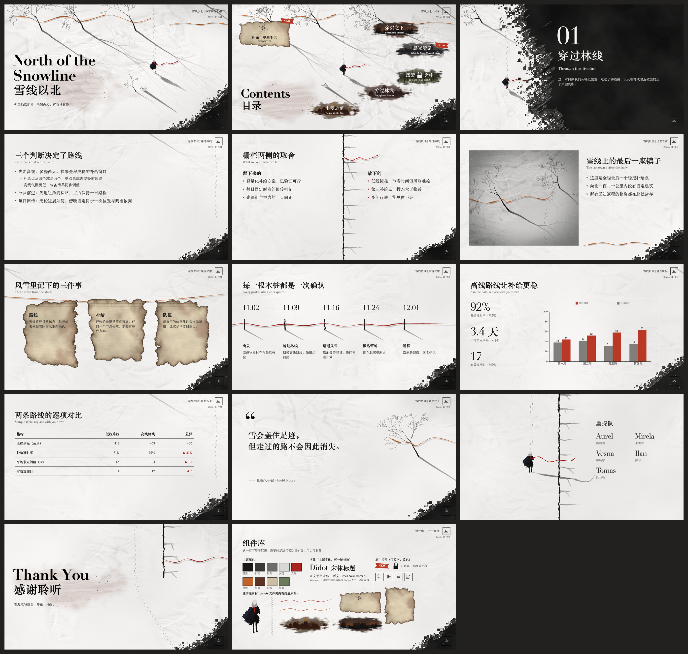

# 明日方舟风格 PPT 模板：雪原墨痕

仿《明日方舟》关卡地图和片尾名单画面的 PowerPoint 模板：雪地、墨色枯树、红绳、木栅栏和焦边便签。共 15 个版式，文字、图表和表格都可以直接编辑。



预览图由 macOS QuickLook 渲染，标题会显示成纯黑，页码会显示成 `‹#›`。在 PowerPoint 里，标题是带斑驳质感的图片填充文字。

## 文件

| 路径 | 内容 |
| --- | --- |
| `雪原墨痕-模板.potx` | 干净模板：15 个版式，1 张空封面 |
| `雪原墨痕-示例.pptx` | 14 页示例，内容虚构，可直接替换 |
| `预览总览.jpg` | 示例页总览 |
| `assets/` | 背景、元素和文字纹理图片 |
| `source/` | 素材和模板的生成脚本 |

## 使用

双击 `雪原墨痕-模板.potx` 新建演示文稿，再从“新建幻灯片”里选版式：

- 封面、章节页、结束页、空白
- 目录地图（5 / 4 / 3 章节）
- 标题 + 正文、双栏（栅栏分隔）、图文（撕边图片）
- 三张焦痕便签、时间线（木桩与红绳）、数据（大数字 + 图表）
- 引言、名单（团队与致谢）

## 字体

主题字体是 Didot（西文标题）、Times New Roman（西文正文）和 Songti SC（中文）。Windows 上缺少 Didot 和 Songti SC，可以在“视图 > 幻灯片母版 > 字体”里换成 Bodoni MT 和思源宋体（需自行安装）。

## 重新生成

需要 Python 3 以及 numpy、scipy、pillow。

```bash
pip install numpy scipy pillow
```

```bash
cd source
```

```bash
PYTHONHASHSEED=0 python3 build_art.py
```

```bash
python3 build_deck.py
```

`build_art.py` 生成 `assets/` 里的图片，也可以只跑某一项，比如 `python3 build_art.py cover`。`build_deck.py` 用这些图片生成 `.potx` 和 `.pptx`。`预览总览.jpg` 和 `source/thumbnail.jpeg` 不由这两个脚本生成。

## 尚未验证

- 撕边图片占位符和图表的“编辑数据”还没有在 PowerPoint 里确认过。
- Windows 版 PowerPoint 没有测试过。

## 声明

这是非官方的风格仿作，与鹰角网络（Hypergryph）无关。“明日方舟”的名称及相关权利归其权利人所有。仓库里的图片全部由 `source/` 中的脚本生成，不含游戏素材。
